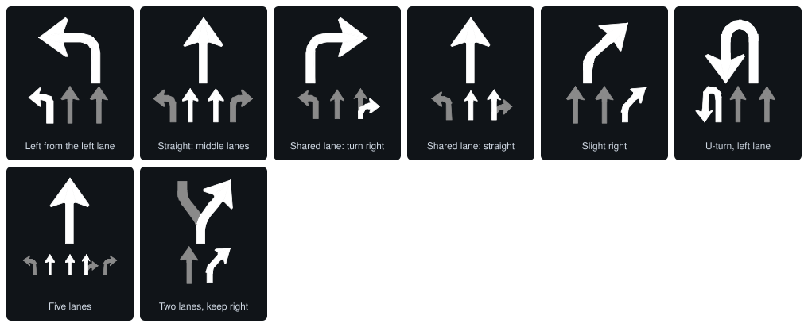

# nbtevo-carplay-advanced

Apple CarPlay add-ons for the BMW / MINI **NBT Evo** head unit (iDrive 5 and iDrive 6): a **CarPlay Advanced Settings** menu in
Media/Radio, and the iPhone's **turn-by-turn directions in the cluster and the head-up display**.

It is an HMI plugin plus a few small libraries that hook into the head unit's own processes at run time. Apart from one line added
to the boot script, no system file is replaced or patched on disk, and one installer script puts it on (and takes it off) over the car's ENET connection, with backups of everything
it touches.

> **Disclaimer.** This project is for **educational purposes only**. Run it only on a car you own, at your own risk: you alone are
> responsible for whatever it does to your head unit, your car and its warranty, and for using it in line with the law where you
> drive. Never operate it while driving. It comes with no warranty of any kind (see [LICENSE](LICENSE)).

## What it does

### On iDrive 5: the CarPlay Advanced Settings menu

iDrive 5 HMIs give CarPlay a slot next to a side panel and send it only the knob's rotation and press. The menu plugin adds what
iDrive 6 has natively, and a bit more:

- **Full-screen CarPlay**: CarPlay over the whole display, without the side panel. MINI: the iPhone renders 1184 x 480 on the
  8.8" (tested in a car). BMW, BMW i and Rolls-Royce: 1440 x 540 on the 10.25", 1280 x 480 on the 8.8" (not tested in a car yet).
- **iDrive control**
  - **Knob tilts**: up / down / left / right move the CarPlay focus; a held tilt repeats.
  - **Touchpad**: the iDrive controller's touch surface as CarPlay's own touchpad. One finger scrolls, a tap selects
    (*Tap touchpad as click*), sensitivity Low / Medium / High, and *Two fingers tap to back* (two-finger slides also move the
    focus).
  - **Rotation as zoom**: turning the knob zooms the map (Apple Maps; Google Maps ignores it).
- **CarPlay directions in HUD** and **HUD effects** (below).
- **Restart to apply**: most switches take effect after a restart of the head unit; this does it from the menu.
- A **safe mode**: after three failed boots in a row with the plugin, nothing is applied until you choose Restart to apply; three more
  disable the plugin.

The menu:

```
Media/Radio > CarPlay Advanced Settings
  Full-screen CarPlay
  CarPlay directions in HUD
  HUD effects >        Fill toward the turn / Blink near the turn / Effect colour > (Orange, Grey, White)
  iDrive control >     Enable knob tilts
                       Touchpad >   Enable touchpad / Tap touchpad as click / Touchpad sensitivity > (Low, Medium, High)
                                    / Two fingers tap to back
                       Enable rotation as zoom
  Restart to apply
```

On iDrive 6 the HMI already does full screen, knob tilts and the touchpad (when the car is coded for it), so there the installer
puts on the turn-by-turn part by default (`--hud`), with a **HUD-only menu** in the same place in Media/Radio:

```
Media/Radio > CarPlay Advanced Settings
  CarPlay directions in HUD
  HUD effects >        Fill toward the turn / Blink near the turn / Effect colour > (Orange, Grey, White)
```

It changes nothing in the HMI itself, and its switches apply at the next CarPlay connection (no restart). The HMI shows it only when the
car is coded for apps (A4A); without that the directions still work, with their default settings. `--full` installs the whole menu
instead (not tried on iDrive 6 in a car).

### On iDrive 5 and 6: CarPlay turn-by-turn in the cluster and the HUD

The plugin reads the guidance the iPhone sends to the car (the maneuver, the distance, the street, the lanes) and shows it where the
BMW navigation would. How it gets there depends on the car's cluster; the installer finds out which one the car has.

| | F-series (MOST cluster, e.g. MINI F54/F55/F56) | G-series and J29 (Ethernet KOMBI) |
|---|---|---|
| Who draws | **We do.** The plugin draws every picture itself, polygon by polygon, on the cluster's `HUDTerminal` over MOST. | **The car does.** The plugin sends the route data to the KOMBI's own guidance service (SOME/IP), and the cluster and the HUD draw it with their own graphics. |
| Pictures | Mapbox's maneuver and lane drawings, turned into HUD polygons (previews below). | The car's own arrows, distance and lane row. |
| Status | **Tested in a car** (MINI F54, HMI 1703): pictures, distance, street, HUD effects, lanes. | **Not tested in a car.** A port of NBT-AAD's car-verified KOMBI stack (see Credits), checked against a fake KOMBI only. |

**HUD effects** (MOST, menu *HUD effects*): the maneuver fills up with the effect colour toward the turn and / or blinks near it. The
start marker never fills or blinks.

The pictures as the plugin draws them (white = the way to go, grey = context). They are built by the plugin's own code from
[Mapbox's drawings](https://github.com/mapbox/mapbox-navigation-ios/tree/v0.40.0/MapboxNavigation) (ISC licence, see NOTICE):




The BMW navigation always wins: while it guides, the CarPlay directions step aside.

## Supported software

The menu plugin patches the HMI's code in memory at fixed addresses, so it supports exact software builds, recognised by file
hashes:

| HMI | Build | |
|---|---|---|
| 006_006_006 | ID5_1703-490-1650ZD Build 139 (MINI F54, 8.8") | tested in a car |
| 006_017_006 | ID5_1803-510-1749MA Build 71 | not tried in a car yet |

Before it changes anything, the installer reads the head unit's HMI and CarPlay library and compares their hashes with the list
above. Only a match proceeds. On any other software it stops there, with nothing changed, and prints a link that opens a GitHub
issue with the hashes it found: that is all that is needed to add a build. The turn-by-turn-only install (`--hud`) patches no HMI
code and does not need a known build.

> **NBT-AAD.** This plugin has **not been tested together with [NBT-AAD](https://github.com/Sq00ky/Supra-iDrive6-Android-Auto)**
> (Android Auto for the NBT Evo). Both are HMI plugins that use the same cluster channels (the MOST `HUDTerminal`, the KOMBI guidance
> service) and similar hooks, so they may conflict. If you run both, please let me know how it goes:
> [open an issue](https://github.com/st1ng/nbtevo-carplay-advanced/issues/new).

## Prerequisites

- **SSH access on the head unit.** The NBT Evo's SSH server (root login over ENET, `169.254.199.99`) must be enabled; on most units
  it is not by default. The installer does everything over that connection.
- **For the menu: the car coded with A4A** (apps), so the HMI loads app plugins such as this menu. CarPlay itself activated and
  working.
- A **Mac or Linux computer** with `ssh` (OpenSSH), an **ENET cable** (OBD to Ethernet), and the ignition on (the head unit
  running). macOS gives the cable a link-local `169.254.x.x` address by itself; on Linux set that wired connection's IPv4 method
  to "Link-Local Only" (`nmcli connection modify <name> ipv4.method link-local`).

## Install

From this folder (the installer uploads `plugin/` next to it), the installer logs in over SSH, checks the head unit, shows what it
will do and asks before changing anything:

```bash
sh carplay-advanced.sh install
```

It then:

1. checks the plugin files, and that the head unit answers;
2. reads the HMI; for the full plugin on iDrive 5 it identifies the software by hash (an unknown build stops here, with nothing
   changed);
3. asks **Proceed?**, uploads the plugin and backs up every file it will replace (on the head unit, and a copy in `BACKUP/` on your
   computer);
4. installs, prints a summary of what is on the head unit now, and offers to **restart** it.

After the restart: **Media/Radio > CarPlay Advanced Settings**. On a first install all options are off; a reinstall keeps them.

Other commands:

```bash
sh carplay-advanced.sh install --dry-run      # every check and the plan, nothing changed
sh carplay-advanced.sh status                 # what is installed, the links, the backups
sh carplay-advanced.sh uninstall              # back to the original state (--keep-config keeps your switches)
sh carplay-advanced.sh restart                # restart the head unit
```

Options: `--hud` / `--full` (turn-by-turn only, or everything), `--cluster most|kombi|both` (where the directions go, instead of
what the installer detects), `--yes` (no questions), `--host user@address`, `--help`.

What changes on the head unit: the plugin folder, the settings folder, and **one line** in the boot script (removed again by
uninstall). Everything else happens at run time and is gone after a restart once the plugin is removed.

## How it works

The short version. [AGENTS.md](AGENTS.md) has everything: every hook, address, file format and finding from the car.

- **The menu** is an HMI plugin (`libCarPlayMenu.so`), the same kind the HMI uses for its own apps. When the HMI starts, the plugin
  patches the HMI's code in memory (every word is checked first), shadows a few system files with path-manager links (a reboot
  forgets them), and hooks the controller and touchpad input.
- **Full-screen CarPlay** widens the CarPlay slot in the HMI's layout (MINI's own layout, or the common one BMW uses; on
  006_017_006 BMW the HMI's own full-screen layout is switched on) and tells the iPhone the larger screen size.
- **Knob and touchpad** reach CarPlay as real CarPlay input devices: `libcppinch.so`, preloaded into the head unit's Connectivity
  process, adds directions to the knob and turns rotation into a pinch on a hidden touchscreen.
- **Directions**: `librghook.so`, preloaded into the iPod/CarPlay process, decodes the iPhone's iAP2 route guidance. The plugin draws
  it on the MOST `HUDTerminal`, or `librghook-kombi.so` sends it to the Ethernet KOMBI.

## Build and test

```bash
./build.sh                                    # plugin/: the ARMv7 QNX libraries and the menu texts
python3 -m unittest discover -s tests         # the tests (macOS / Linux, needs clang)
python3 tools/hud_previews.py                 # docs/hud-*.svg, after a change to the pictures
```

Building needs only `clang` and `ld.lld`, and no BMW files: the libraries link against empty stand-ins that carry only the names of
the head unit's libraries. `plugin/` is committed prebuilt, so installing needs no build.

The tests run the real code on the computer: the menu's file patches, the HUD pictures, the iAP2 decoder, the KOMBI client against a
fake KOMBI, and the installer against a simulated head unit (its shell, file system and tools).

| Folder | What |
|---|---|
| `src/` | The plugin and its libraries (C / freestanding C++) |
| `plugin/` | The built plugin: what the installer uploads |
| `tests/` | Unit tests |
| `tools/` | The HUD picture generator (from Mapbox's drawings), the previews, and two scripts for the head unit: `hud_probe.sh` (probes the cluster's HUD) and `hud_sim.sh` (a pretend route, to see the HUD effects without driving) |
| `docs/` | The HUD previews |
| `.claude/skills/` | Skills for AI coding agents (below) |

### Skills for AI agents

Much of this project was built with an AI coding agent ([Claude Code](https://claude.com/claude-code)). `AGENTS.md` is written for
such agents as much as for people, and `.claude/skills/` holds two task guides that an agent loads when the task comes up:

- **`hmi-menu`**: adding, moving or removing menu rows. The menu lives in three files that must agree (the XML, the texts and the
  handlers); its `check_menu.py` checks that they do.
- **`hud-glyphs`**: the HUD pictures: regenerating them from Mapbox's drawings, changing the procedural ones (roundabouts, lanes,
  digits), the piece budget, and `preview.py`, which renders any picture to SVG exactly as the head unit builds it.

## Credits

- **[NBT-AAD](https://github.com/Sq00ky/Supra-iDrive6-Android-Auto)** by nanaisu: Android Auto for the NBT Evo. This project stands on
  their reverse engineering: the HMI plugin interface, the MOST/DSI client and the HUD terminal layout, and the Ethernet KOMBI
  route-guidance stack, which `src/kombi.h` ports (with their captured route graph, `src/kombitemplate.h`, unchanged). Thank you.
- **[NBT-AAD USB Tools](https://github.com/Yalozo/nbt-aad-usb-tools)** by Yalozo: the installer's pre-installation checks follow
  theirs.
- **[Mapbox Navigation SDK for iOS](https://github.com/mapbox/mapbox-navigation-ios)** v0.40.0: the maneuver and lane drawings
  (ISC licence), turned into HUD polygons by `tools/hud_glyphs.py`.
- [ftojke/BMW-iDrive6-CarPlay-HUD](https://github.com/ftojke/BMW-iDrive6-CarPlay-HUD),
  [JayJay3071/nbt-android-auto](https://github.com/JayJay3071/nbt-android-auto),
  [luka-dev/mib2q-carplay-rgi](https://github.com/luka-dev/mib2q-carplay-rgi) and [f-io/LIVI](https://github.com/f-io/LIVI):
  findings and formats that helped (AGENTS.md, References).

## Feedback

Tried it on another car or another software build, found a bug, or run it next to NBT-AAD? Please
[open an issue](https://github.com/st1ng/nbtevo-carplay-advanced/issues/new).

## License

[PolyForm Noncommercial 1.0.0](LICENSE), the installer included: free for personal, hobby, research and educational use, not for
commercial use. The exceptions are Mapbox's drawings (`src/hudglyphs.h` and the previews in `docs/`, ISC) and the files from NBT-AAD
(PolyForm Noncommercial, with their notice). Details in [NOTICE](NOTICE).

Not affiliated with BMW, MINI, Apple or Harman. BMW, MINI, iDrive and CarPlay are trademarks of their owners. For educational
purposes only, on your own car and at your own risk (see the disclaimer at the top): it changes how your head unit runs, though
everything it changes can be undone with `uninstall`.
